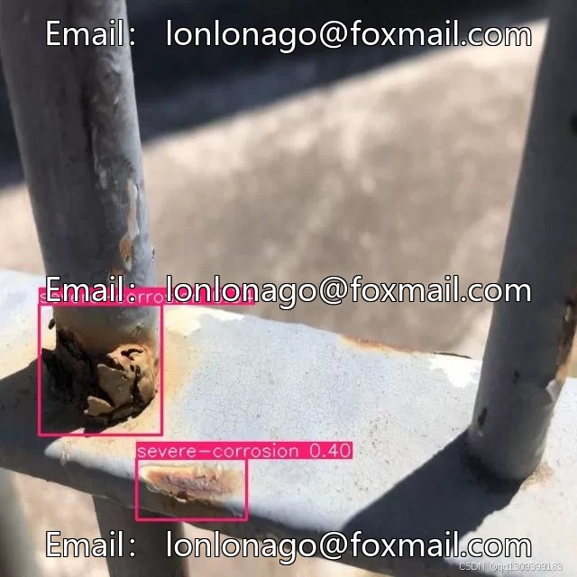
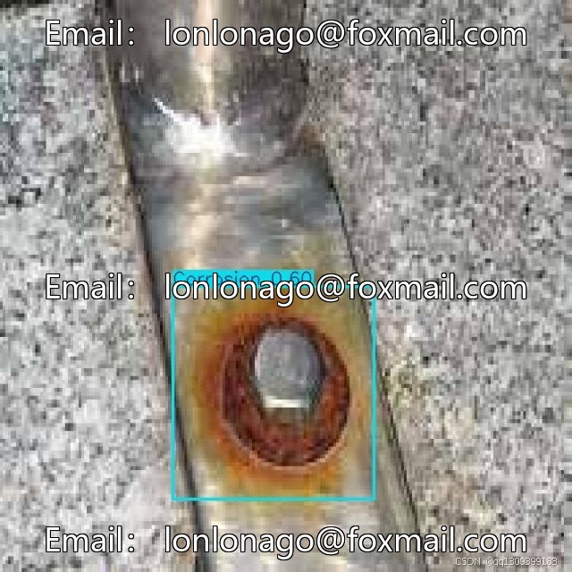
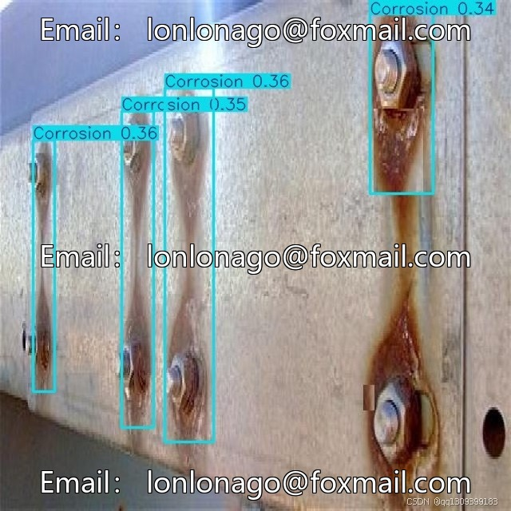
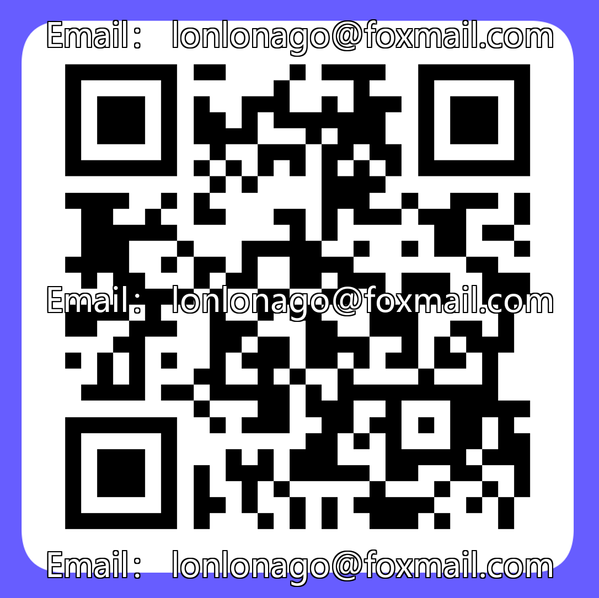

# Industrial corrosion detection dataset, trained based on YOLOv11 model, supports 18 types of corrosion.

## Body

Industrial corrosion detection dataset, trained based on YOLOv11 model, supports recognition of 18 types of corrosion, covering mild, moderate, severe corrosion and rusting, oxidation corrosion, crevice corrosion, etc. The dataset includes rust markings, suitable for industrial asset management, corrosion monitoring, and development of preventive maintenance systems.

Model Architecture: YOLOv11, Ultralytics framework, 100 training rounds, batch size 16, image size 640x640, Adam optimizer, learning rate 0.001, warm-up for 5 rounds, momentum 0.937, weight decay 0.0005, data augmentation to enhance robustness. Training completed on NVIDIA GPU using Roboflow platform preprocessing.

Virtual materials, once sold, are non-refundable.
Interested friends, click "I want" to proceed.

## Images

## Payment

Here is a pay link on Stripe ( https://buy.stripe.com/3cs8yP7sY87d0vu9AB ). Please contact me lonlonago@foxmail.com after funding $89, and I will send you a complete data files , thank you!

